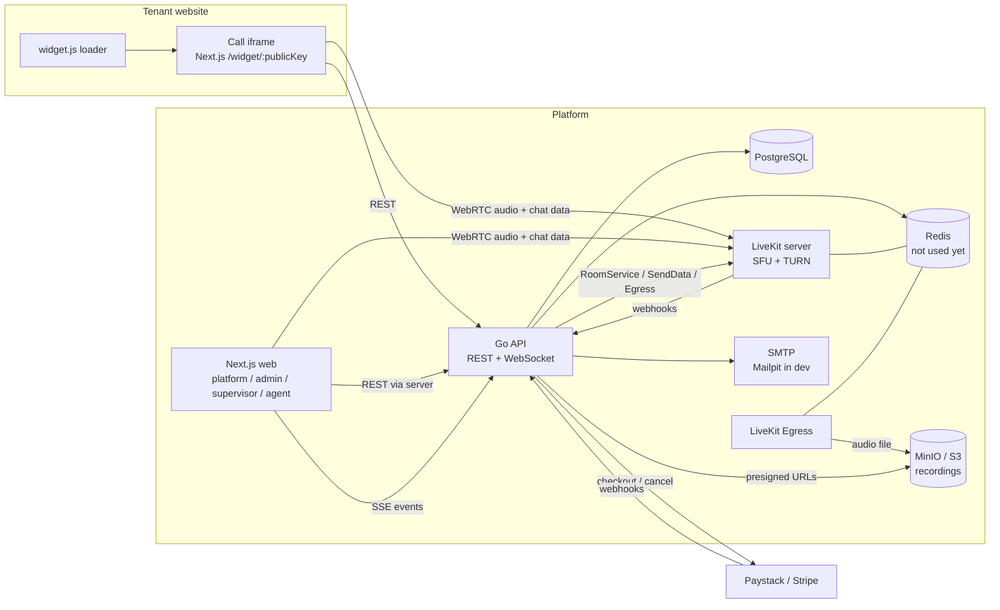
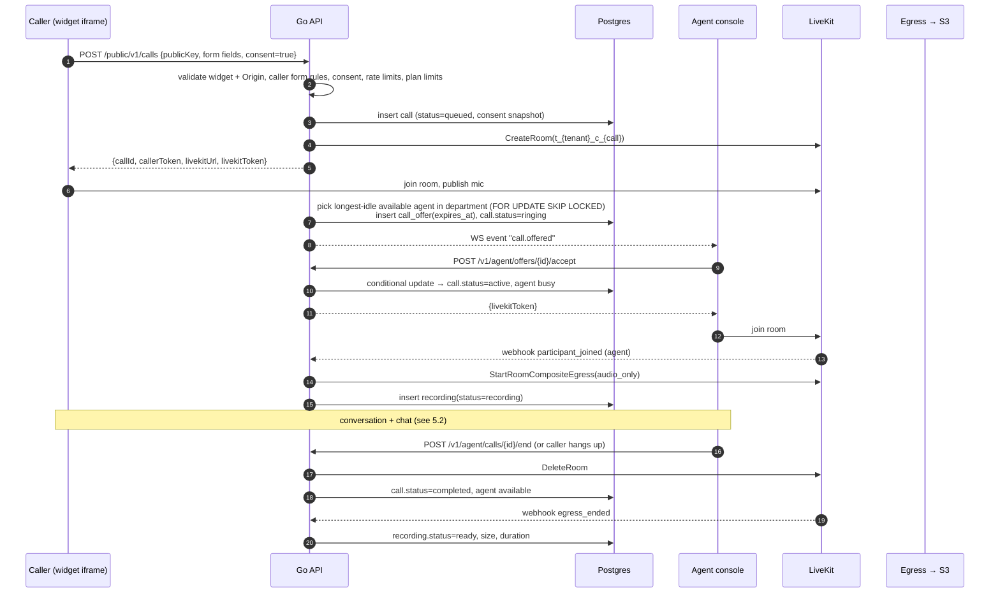

# CallCenter — Architecture & Data Model (v0.5)

Status: **M1 (foundation), M2 (widgets & caller side) and M3 (routing & consoles) implemented**; M4–M6 not started. Details of M3 and why it differs from v0.4 are in [M3-DESIGN.md](M3-DESIGN.md). Each item is labelled **Decision** (you confirmed it),
**Proposal** (my recommendation, needs your OK), **Assumption** (I am guessing, please correct me) or **Open question**.

---

## 1. Product summary

A multi-tenant SaaS where each business (**tenant**) connects its customer-care team to its customers
over voice calls that run on the internet (WebRTC) instead of the phone network, so callers do not spend airtime.

1. A customer clicks a **"Call us" widget** embedded on the tenant's website. Each widget belongs to a **department**.
2. The caller fills in the tenant's caller form (if enabled), ticks the **recording-consent** box, and a **call room** is created.
3. An **available agent in that department** is offered the call, accepts it, and they talk. They can also **text-chat** during the call.
4. The call and its chat are **recorded and saved**. Tenant admins can list calls, play recordings, read chat transcripts and soft-delete recordings.
5. If no agent picks up in time, the caller can leave a **callback request**.
6. Tenants are on a **plan** (free tier or paid) with limits, paid through **Paystack or Stripe**.

### Confirmed decisions

| # | Decision |
|---|----------|
| D1 | Backend: **Go**. Frontend: **Next.js** (App Router, multi-page, not an SPA). |
| D2 | Media: **self-hosted LiveKit** (WebRTC SFU) + **LiveKit Egress** for recording. |
| D3 | Caller entry point: an **embeddable web widget** only. |
| D4 | Tenancy: **one shared PostgreSQL schema** with `tenant_id` on every tenant-owned table, enforced in the repository layer **and** by Postgres Row-Level Security (RLS). |
| D5 | No agent before the maximum wait → the caller gets a **callback request form**. |
| D6 | Recording is **always on**. The caller must tick an **explicit consent checkbox** before calling. |
| D7 | Tenant admins can **soft-delete** recordings: hidden from the tenant, file kept, the **platform admin can view and restore** them. The deletion is audit-logged. |
| D8 | Caller form: the tenant admin turns it **on or off** and sets **each field** (name, phone, email) to `hidden`, `optional` or `required`. |
| D9 | Roles: platform admin, tenant admin, **supervisor (live view only, no listen-in)**, agent. |
| D10 | **Departments in v1.** An agent can belong to **many** departments. |
| D11 | Onboarding: **self-service sign-up and** creation by the platform admin. |
| D12 | **Plans + payments with a free tier.** The platform admin manages plans (CRUD). Limits: **agent seats, call minutes per month, recording storage, departments, widgets**. |
| D13 | Payments: **Paystack and Stripe behind one provider interface**. |
| D14 | Media is **audio plus in-call text chat**, and the chat transcript is saved. No video. |
| D15 | Hosting **not decided**, so everything stays portable: Docker images, standard Postgres, S3-compatible storage, SMTP. No cloud-specific services. |
| D16 | Minutes and storage caps: **the tenant admin chooses, per cap,** between **block** (refuse new calls and show the callback form) and **pay overage**. The platform admin sets overage rates per plan price. Free-tier tenants can only **block** (no payment method). |
| D17 | Soft-deleted recordings **still count** toward the storage quota. |
| D18 | Payment failure → `past_due` for **14 days**, then automatic fallback to the free tier. |
| D19 | The provider is chosen **by currency**: NGN → Paystack, other currencies → Stripe. |
| D20 | Self-signup tenants go **live after email verification**, with no manual approval. |
| D21 | Consent text: a **platform default that tenants can override**. The text actually shown is saved with each call. |
| D22 | Supervisors see **only their assigned departments**: live board and call history. |
| D23 | Departments have **business hours** (weekly schedule + timezone). Outside hours the widget shows the callback form immediately. |
| D24 | Chat is available **only once an agent has joined** (call `active`). |
| D25 | Server → browser real-time events use **Server-Sent Events** through a Next.js route handler (the browser still talks only to Next.js), not WebSockets. Events are hints; clients re-read state. |
| D26 | Event fan-out uses Postgres **LISTEN/NOTIFY** (sent inside the transaction, delivered on commit), so **Redis is not required** until LiveKit or hosting needs it. |
| D27 | An agent's `busy`/`ringing` state is **derived** from calls and offers, never stored. The database enforces one pending offer and one active call per agent. |

---

## 2. System components



| Component | Responsibility |
|-----------|----------------|
| **Go API** | All business logic: auth, tenants, users, departments, widgets, calls, routing, presence, chat, recordings, callbacks, plans, billing, limits, audit log. The only component that writes to Postgres. |
| **Next.js web** | Platform console, tenant-admin console, supervisor live board, agent console, widget iframe page. No business logic. |
| **widget.js** | Vanilla-JS loader the tenant pastes onto their site. It renders the button and opens the iframe with `allow="microphone"`, isolated from the host site's CSS and JS. |
| **PostgreSQL** | The source of truth for all durable state, including presence and call assignment, because assignment must be transactional. |
| **Redis** | Not used in M3 (D26). A single LiveKit node does not need it; it becomes necessary for a multi-node LiveKit or Egress. Real-time fan-out uses Postgres LISTEN/NOTIFY. |
| **LiveKit** | Media routing with built-in TURN for strict NAT and mobile networks. Its **data channel** carries chat messages. |
| **LiveKit Egress** | Records each call room as a mixed audio-only file and uploads it to object storage. |
| **MinIO / S3** | Private bucket. Playback only through short-lived presigned URLs issued after an authorization check. |
| **SMTP** | Email verification, password reset, agent invitations, callback notifications. Behind a `Mailer` interface. |
| **Payment providers** | Paystack and Stripe, behind a `billing.Provider` interface. |

**Proposal:** the Go API is one **modular monolith** (one deployable, domain packages inside), not microservices.

---

## 3. Roles & authorization

| Role | Scope | Can do |
|------|-------|--------|
| `platform_admin` | Whole system (`tenant_id` NULL) | CRUD tenants and plans, suspend tenants, view subscriptions/payments, view and **restore soft-deleted recordings**, view the audit log, set the default consent text. |
| `tenant_admin` | One tenant | CRUD users (agents, supervisors, admins), departments (incl. business hours), widgets and caller-form config. View all calls, recordings and chat. Soft-delete recordings. Manage callbacks. Manage billing and cap policies. Override the consent text. |
| `supervisor` | **Assigned departments** (D22) | Live board (queues, active calls, agent statuses) and call history for those departments. **No listen-in, no deletes.** |
| `agent` | One tenant | Set own availability, accept or decline offers, handle calls and chat, work callbacks for their departments, view **own** history. |

- **Assumption:** a user belongs to exactly one tenant, and email is globally unique.
- **Assumption:** supervisors and admins count toward **agent seats** only if they can take calls. A user can be an `agent` in departments regardless of role (see `department_members`).
- Authorization is enforced in the **service layer**. Tenant scope always comes from the session, never from request parameters (prevents IDOR).

---

## 4. Caller experience (widget)

1. **Pre-call screen:** the caller form (if enabled) is rendered from the widget's config, with each field hidden, optional or required (D8), plus the **consent checkbox** with the consent text (D6). The *server* validates both against the widget config. The client is never trusted.
2. **Department availability check:** the callback form is shown straight away instead of starting a call if any of these is true:
   - the department is **outside business hours** (D23),
   - **no agent in the department is online**,
   - a minutes or storage cap is reached **and** the tenant's policy for that cap is `block` (D16).
3. **Waiting:** a queue position is shown.
4. **In call:** audio, mute, hang-up, chat panel.
5. **Max wait reached / no answer:** the call becomes `missed` and the caller is offered the **callback form** (name, contact, reason, prefilled from the caller form).
6. **Ended:** a thank-you screen.

The **consent text shown is stored on each call** (snapshot), so there is proof of exactly what the caller agreed to.

After creating a call the API returns a **caller token** (opaque, call-scoped, short-lived, stored hashed). The iframe uses it for queue status, chat, hang-up and the callback request. The caller never gets a user session.

---

## 5. Call flow & routing



### 5.1 Routing rules (Proposal)

- An agent handles **one call at a time** (Assumption).
- A call is routed only to agents who are **members of the widget's department** (D10).
- Selection: **longest-idle available member** (`agent_presence.idle_since`). Offer timeout: **20 s** by default (tenant setting). Decline or timeout → next agent, and an agent who declined or timed out is not offered that call again. Two timeouts in a row → agent set to `away`.
- No one available → the call stays `queued`, **FIFO per department**. When an agent becomes available, they get the **oldest queued call across all their departments**.
- Max wait: a tenant setting. Exceeding it → `missed` → callback form.
- **Works with several API instances:** every dispatch pass runs under the tenant's row lock (`SELECT … FOR UPDATE` on `tenants`), offers carry `expires_at` in Postgres, and a 2-second sweeper handles expiry, max wait and stale agents. Accepting is a pair of conditional updates (offer `pending`, call `ringing`), so two agents can never both win a call.

### 5.2 In-call chat (Proposal)

The client sends a message to the API (`POST .../calls/{id}/messages`, authenticated by caller token or agent session). The API **validates and persists** it in `call_messages`, then pushes it to the room with LiveKit `RoomService.SendData`. Both sides already receive it over their LiveKit connection.
- One write path, so the saved transcript and what users saw cannot diverge, and clients cannot inject unpersisted messages.
- No extra WebSocket for the caller.
- Messages are plain text only (no HTML), length-limited and rate-limited, and rendered escaped.
- Chat is accepted **only while the call is `active`** (D24). The API rejects messages in any other state.

### 5.3 Failure & edge cases

| Case | Behaviour |
|------|-----------|
| Caller closes tab while queued/ringing | `participant_left` webhook → `abandoned`, offer cancelled. |
| Either side drops mid-call | LiveKit reconnect grace period, then the call ends with `caller_disconnected` / `agent_disconnected`. The agent is set `offline`. |
| Agent stops heartbeating | Set `offline` and excluded from routing. |
| Max wait exceeded | `missed` → callback form offered. |
| Egress fails | Recording `failed` with the error. The call is unaffected and the admin UI shows "recording unavailable". |
| Duplicate/replayed webhooks (LiveKit, Paystack, Stripe) | Signature verified, handled idempotently by event id. |

---

## 6. Callback requests (D5)

- Created from the widget (after `missed`, or immediately when the department has no one online), linked to the call when there is one.
- Status: `open → claimed → completed | cancelled`. Notes are stored.
- **Proposal:** department members **claim** callbacks from `/agent/callbacks`. Tenant admins see and reassign all of them. New callbacks notify online department members over WebSocket and tenant admins by email.
- **Assumption:** the agent returns the call outside the platform (phone or email). The platform tracks the request but does not place outbound calls (the caller is not reachable through the widget once they leave).

---

## 7. Recordings, soft delete & audit (D6, D7)

- Path: `tenants/{tenantId}/recordings/{callId}.ogg` in a private bucket.
- Playback and download: a presigned URL (≈5 min TTL), issued only after an authorization check, and **audit-logged**.
- Soft delete (tenant admin): sets `deleted_at` and `deleted_by` and writes an audit entry. The recording disappears from every tenant query and **the file is kept**. It **still counts toward the storage quota** (D17).
  - Consequence: a tenant can never lower its storage usage. Its only options at the cap are to upgrade or pay overage (or be blocked). The billing page states this.
- Platform admin: lists soft-deleted recordings across tenants, can play them, and can **restore** them (clears `deleted_at`, writes an audit entry).
- `audit_logs` covers recording play/download/delete/restore, user role changes, plan changes and tenant suspension.

---

## 8. Plans, billing & limits (D12, D13)

### Model
- **Plans** (platform-admin CRUD) define limits: `max_agents`, `max_call_minutes_per_month`, `max_storage_bytes`, `max_departments`, `max_widgets`. NULL means unlimited.
- **Plan prices**: currency + interval (monthly/yearly) + amount, plus **overage rates** in the same currency: per extra call minute, and per extra GB of storage per billing period (D16). Each price is linked to its provider object (Paystack `plan_code` or Stripe `price_id`) when the platform admin syncs it.
- **Provider by currency (D19):** a config mapping `NGN → paystack`, everything else `→ stripe`. A price's currency decides its provider, and the tenant never picks.
- Exactly one plan is flagged as the **free tier**. New tenants (self-signup or admin-created) start on it.
- Each tenant has one **current subscription**.

### Cap policies & overage (D16)
- Tenant settings hold `minutes_cap_policy` and `storage_cap_policy`, each `block | overage`. The default is `block`. `overage` can only be chosen on a paid subscription, and the service rejects it on the free tier.
- Falling back to the free tier (D18) resets both policies to `block`.
- At each billing period close, a job snapshots usage into `usage_periods`:
  - call seconds,
  - storage bytes (including soft-deleted recordings, per D17),
  - the overage amount at the price's rates.
- If the overage amount is above zero, the job charges it through the provider:
  - **Stripe:** an invoice item on the subscription.
  - **Paystack:** a charge on the saved card authorization.
- The charge result is recorded in `payments`. A failed overage charge puts the subscription into the same `past_due` flow.
- The admin is emailed at **80% and 100%** of each cap, whichever policy is set.

### Payment failure & downgrade (D18)
- A failed payment webhook → subscription `past_due`, with `past_due_since` set and the admin emailed.
- A successful payment within **14 days** → back to `active`.
- After 14 days, a sweeper moves the tenant to the **free tier**. Nothing is deleted. Creating resources over the limit is blocked, and agents over the seat limit cannot go available (the admin picks who stays active). The minutes and storage caps then apply with `block`.

### Provider abstraction
```go
type Provider interface {
    Name() ProviderName
    SyncPrice(ctx, PlanPrice) (externalID string, err error)
    CreateCheckout(ctx, CheckoutRequest) (redirectURL string, err error)
    CancelSubscription(ctx, externalSubscriptionID string, atPeriodEnd bool) error
    ChargeOverage(ctx, OverageCharge) (externalReference string, err error)
    ParseWebhook(r *http.Request) (BillingEvent, error) // verifies signature, maps to internal event
}
```
Paystack is implemented first, then Stripe. The billing service only knows the internal `BillingEvent` types
(`subscription.activated`, `payment.succeeded`, `payment.failed`, `subscription.cancelled` …).
Subscription state changes **only** in response to verified webhooks, never from the browser redirect.

### Limit enforcement (in services, not the UI)
| Limit | Checked when |
|-------|--------------|
| Agent seats | Creating or re-activating a call-taking user |
| Departments / widgets | Creating them |
| Call minutes / month | Creating a call (sum of answered call seconds in the current period). Blocked only if the policy is `block`. |
| Recording storage | Creating a call (sum of `size_bytes` of all the tenant's recordings, soft-deleted included). Blocked only if the policy is `block`. |

**Proposal:** compute usage with indexed `SUM` queries at first, and add counter tables only if measurements show they are needed (YAGNI).

---

## 9. Data model (PostgreSQL)

All IDs are `uuid` v7. All tables have `created_at`/`updated_at timestamptz`. `tenant_id` tables are covered by RLS.

```text
── Identity ─────────────────────────────────────────────
tenants
  id, name, slug UNIQUE, status (pending_verification|active|suspended)

tenant_settings                               -- typed columns so Postgres enforces ranges (built in M1)
  tenant_id PK FK CASCADE,
  offer_timeout_seconds (5–120), max_queue_wait_seconds (30–3600), consent_text_override NULL
  -- minutes_cap_policy / storage_cap_policy columns are added in M5

platform_settings                             -- single row (id = 1)
  default_consent_text, updated_by FK

users
  id, tenant_id FK NULL, email citext UNIQUE, password_hash NULL (NULL until invite accepted),
  full_name, role (platform_admin|tenant_admin|supervisor|agent),
  status (invited|active|disabled), email_verified_at, last_login_at
  CHECK ((role='platform_admin') = (tenant_id IS NULL))

sessions
  id, user_id FK CASCADE, token_hash UNIQUE, expires_at, revoked_at, ip, user_agent

user_tokens                                   -- email verification, password reset, invitations
  id, user_id FK CASCADE, purpose (verify_email|reset_password|invite),
  token_hash UNIQUE, expires_at, used_at

── Organisation ─────────────────────────────────────────
departments
  id, tenant_id, name, description, is_active,
  timezone (IANA, e.g. Africa/Lagos)
  UNIQUE (tenant_id, name)

department_business_hours                     -- D23; several ranges per weekday allowed
  id, department_id FK CASCADE, tenant_id,
  weekday smallint (0=Sun … 6=Sat), opens_at time, closes_at time
  CHECK (opens_at < closes_at)
  -- a department with no rows is treated as closed; the UI offers a "24/7" preset

department_members                            -- M:N agents ↔ departments (who takes calls)
  department_id FK CASCADE, user_id FK CASCADE, tenant_id
  PK (department_id, user_id)

department_supervisors                        -- D22; which departments a supervisor sees
  department_id FK CASCADE, user_id FK CASCADE, tenant_id
  PK (department_id, user_id)

widgets
  id, tenant_id, department_id FK, name, public_key UNIQUE,
  allowed_origins text[], is_active,
  appearance jsonb (label, colour, greeting),
  caller_form jsonb  -- {"enabled":true,"fields":{"name":"required","phone":"optional","email":"hidden"}}

agent_presence                                -- built in M3
  user_id PK, tenant_id, status (offline|available|away),   -- the agent's own choice; busy/ringing are derived (D27)
  status_changed_at, idle_since, last_heartbeat_at, consecutive_timeouts
  INDEX (tenant_id, idle_since) WHERE status = 'available'  -- longest-idle lookup

── Calls ────────────────────────────────────────────────
calls
  id, tenant_id, widget_id FK, department_id FK, room_name UNIQUE,
  status (queued|ringing|active|completed|abandoned|missed|failed),
  caller_name, caller_phone, caller_email (all NULL-able, per form config),
  consent_text, consent_given_at,
  caller_token_hash UNIQUE, caller_ip inet, caller_user_agent,
  assigned_agent_id FK NULL (ON DELETE SET NULL), queued_at, answered_at, ended_at, end_reason
  UNIQUE (assigned_agent_id) WHERE status = 'active'               -- one active call per agent
  INDEX (tenant_id, queued_at DESC)
  INDEX (department_id, queued_at) WHERE status = 'queued'       -- FIFO dispatch
  INDEX (assigned_agent_id, queued_at DESC)
  INDEX (tenant_id, answered_at)                                   -- minutes usage

call_offers                                   -- built in M3
  id, tenant_id, call_id FK, agent_id FK NULL (ON DELETE SET NULL), offered_at, expires_at, responded_at,
  outcome (pending|accepted|declined|timeout|cancelled)
  UNIQUE (call_id) WHERE outcome='pending'
  UNIQUE (agent_id) WHERE outcome='pending'                        -- one live offer per agent
  INDEX (expires_at) WHERE outcome='pending'

call_messages
  id, tenant_id, call_id FK, sender_type (caller|agent), sender_user_id FK NULL,
  body text (length-checked), sent_at
  INDEX (call_id, sent_at)

recordings
  id, tenant_id, call_id FK UNIQUE, egress_id UNIQUE,
  status (recording|processing|ready|failed),
  storage_key, content_type, size_bytes, duration_seconds, started_at, ended_at, error,
  deleted_at NULL, deleted_by FK NULL
  INDEX (tenant_id, created_at DESC) WHERE deleted_at IS NULL     -- tenant listing
  INDEX (tenant_id) INCLUDE (size_bytes)                           -- storage quota (includes soft-deleted, D17)

callback_requests
  id, tenant_id, department_id FK, call_id FK NULL,
  name, phone, email, reason,
  status (open|claimed|completed|cancelled), claimed_by FK NULL, claimed_at,
  resolution_notes, resolved_at
  INDEX (department_id, status, created_at)

── Billing ──────────────────────────────────────────────
plans
  id, code UNIQUE, name, description, is_free, is_public, is_active,
  max_agents, max_call_minutes_per_month, max_storage_bytes, max_departments, max_widgets  (NULL = unlimited)
  UNIQUE (is_free) WHERE is_free                                   -- exactly one free tier

plan_prices
  id, plan_id FK, currency, interval (monthly|yearly), amount_minor bigint, is_active,
  overage_per_minute_minor bigint, overage_per_gb_minor bigint      -- D16; provider derived from currency (D19)

plan_price_provider_refs
  plan_price_id FK, provider (paystack|stripe), external_id
  PK (plan_price_id, provider)

subscriptions
  id, tenant_id UNIQUE, plan_id FK, plan_price_id FK NULL (NULL on free),
  provider NULL, external_customer_id, external_subscription_id,
  status (active|past_due|cancelled|incomplete), past_due_since NULL,     -- D18 sweeper
  current_period_start, current_period_end, cancel_at_period_end

usage_periods                                 -- snapshot at each period close
  id, tenant_id, subscription_id FK, period_start, period_end,
  call_seconds, storage_bytes, overage_amount_minor, currency,
  overage_payment_id FK NULL
  UNIQUE (tenant_id, period_start)

payments
  id, tenant_id, subscription_id FK, kind (subscription|overage), provider,
  external_reference UNIQUE, amount_minor, currency, status (succeeded|failed|refunded), paid_at

billing_webhook_events                        -- idempotency + debugging
  id, provider, external_event_id, type, payload jsonb, processed_at, error
  UNIQUE (provider, external_event_id)

── Audit ────────────────────────────────────────────────
audit_logs
  id, tenant_id NULL, actor_user_id FK NULL, action, entity_type, entity_id,
  metadata jsonb, ip, created_at
  INDEX (tenant_id, created_at DESC)
```

**Tenant isolation (D4):** the repository always filters by the context's `tenant_id`. As defence in depth, RLS policies use `current_setting('app.tenant_id')`, set with `SET LOCAL` per transaction, and the app's DB role has no `BYPASSRLS`. Platform-admin queries and webhook intake use a separate, explicit code path. Integration tests assert that tenant A cannot reach tenant B's rows through any repository.

---

## 10. Backend (Go) structure — Proposal

```text
backend/
  cmd/api/main.go                 -- wiring only
  internal/
    platform/                     -- config, slog logger, postgres (pgx), redis, httpx, mailer
    auth/                         -- login/logout, sessions, signup, verification, reset, invites, guards
    tenant/                       -- tenant CRUD (platform), tenant settings
    user/                         -- tenant user CRUD
    department/                   -- departments + membership
    widget/                       -- widget CRUD, caller-form config, public config lookup
    presence/                     -- availability, heartbeats
    call/                         -- lifecycle (create, end), public caller endpoints; talks to routing through a narrow interface
    routing/                      -- dispatcher, offers (accept/decline/timeout/max wait), sweeper, agent session API
    board/                        -- supervisor live board read model (scoped to assigned departments)
    chat/                         -- call messages
    recording/                    -- metadata, playback URLs, soft delete/restore
    callback/                     -- callback requests
    billing/                      -- plans, subscriptions, payments, limits
      paystack/  stripe/          -- Provider implementations
    audit/                        -- audit log writer + queries
    media/                        -- LiveKit adapter (rooms, tokens, SendData, egress, webhooks)
    realtime/                     -- Postgres LISTEN/NOTIFY → in-process hub → SSE streams
  migrations/
```

Each domain package has the same shape: `handler.go` (HTTP + request DTOs + `Validate()`) → `service.go` (rules, authorization, limits) → `repository.go` (interface + pgx implementation) and `model.go`. Request DTOs are never DB models. Services depend on interfaces (`media.Provider`, `billing.Provider`, `Mailer`, repositories), so all of them can be faked in tests.

**Dependencies:** stdlib `net/http` ServeMux, `jackc/pgx/v5`, `pressly/goose`, `livekit/server-sdk-go`, `golang.org/x/crypto/argon2`, `minio/minio-go/v7`, `stripe/stripe-go`. **Paystack:** there is no official Go SDK, so I'll write a thin HTTP client in `billing/paystack` (stdlib only).

**Auth & security**
- Opaque session tokens (stored hashed in `sessions`, revocable). The **browser only talks to Next.js**: the token lives in an `HttpOnly; Secure; SameSite=Lax` cookie set by Next.js, and the Next.js server forwards it to the Go API as `Authorization: Bearer …`. The API never reads cookies, so it is not exposed to CSRF.
- CSRF protection at the Next.js layer: SameSite cookie + Server Actions' built-in `Origin`/`Host` check.
- Client IP: Next.js forwards `X-Forwarded-For`; the API trusts it only from peers listed in `TRUSTED_PROXIES`.
- Every query runs in a transaction that sets the RLS scope (`InTenant` / `InPlatform`); repositories cannot run outside one.
- Real-time streams (SSE) are authenticated like any request; the topics are derived from the session on the server, never named by the client, and each user may hold at most 3 open streams.
- Login and signup are rate-limited. Passwords use Argon2id.
- New agents get an **invite email** and set their own password. Admins never handle passwords.
- LiveKit tokens are room-scoped and short-lived. The caller can only publish audio and receive data.
- Public widget endpoints: embedding restricted to each widget's allowed websites via CSP `frame-ancestors` on the iframe page (browser-enforced; origins must be `https`, except localhost in development), the loader's config endpoint returns 404 to other origins, per-IP rate limits on call creation, and a cap of 50 live calls per tenant. Consent text is snapshotted from server-side settings, never taken from the client.
- Payment and LiveKit webhooks: signature verification + an idempotency table.

---

## 11. Frontend (Next.js) pages — Proposal

```text
Public / auth
  /signup  /verify-email  /login  /forgot-password  /reset-password  /accept-invite

Platform admin
  /platform/tenants              list · /new · /[id] (incl. subscription, usage) · /[id]/edit
  /platform/plans                list · /new · /[id] · /[id]/edit (prices, provider sync)
  /platform/recordings/deleted   soft-deleted recordings across tenants · restore
  /platform/audit-logs
  /platform/settings             default consent text

Tenant admin
  /admin                         overview (usage vs plan limits, today's calls)
  /admin/users                   list · /new (invite) · /[id] · /[id]/edit
  /admin/departments             list · /new · /[id] (agents, supervisors, business hours) · /[id]/edit
  /admin/widgets                 list · /new · /[id] (embed snippet, caller-form preview) · /[id]/edit
  /admin/calls                   list (filters, pagination) · /[id] (recording player, chat transcript, offer timeline, soft delete)
  /admin/callbacks               list · /[id]
  /admin/billing                 current plan, usage vs caps, cap policies (block/overage), change plan, payment history
  /admin/settings                timeouts, max wait, consent text override

Supervisor (live board also visible to tenant admins)            -- built in M3
  /live                          real-time queues, active calls, agent statuses (scoped to assigned departments)
  /supervisor/calls · /supervisor/calls/[id]   history for assigned departments (read-only)

Agent                                                              -- console built in M3 (chat in M4)
  /agent                         console: availability, incoming offer, in-call (mute, end, chat)
  /agent/calls · /agent/calls/[id]
  /agent/callbacks · /agent/callbacks/[id]

Widget
  /widget/[publicKey]            iframe: form + consent → waiting → in call + chat → ended / callback form
```

Every list and form page has loading, empty, error and success states.

---

## 12. Infrastructure

- **Local dev:** `docker-compose` with postgres, redis, livekit, livekit-egress, minio and mailpit. The Go API and Next.js run natively.
- **Portable production (D15):** the API and web as Docker images, any Postgres 16+, any S3-compatible store, any SMTP.
- **LiveKit:** needs a public IP with UDP open (or TURN/TLS on 443) and a TLS domain. **Egress** is CPU-heavy and runs on its own node(s).
- **Monorepo layout:** `backend/`, `web/` (including `public/widget.js`), `deploy/`, `docs/`.

---

## 13. Remaining assumptions to confirm

All earlier open questions are now decided (D16–D24). These assumptions remain, and I'll proceed with them unless you say otherwise:

1. **Supervisor history (D22)** includes chat transcripts and **recording playback** (read-only, audit-logged) for their departments.
2. **Public holidays / one-off closures** for business hours are **not in v1**. Only the weekly schedule.
3. **Calls already queued when a department closes** continue until answered or the max wait is reached. Closing only stops *new* calls.
4. **An agent handles one call at a time.**
5. **A user belongs to exactly one tenant**, and email is globally unique.

---

## 14. Milestones

| # | Milestone | Done when |
|---|-----------|-----------|
| M1 ✅ | **Foundation:** monorepo, compose, migrations, RLS, auth (login, sessions, signup, email verification, reset, invites), platform tenant CRUD, tenant user CRUD, departments (members, supervisors, business hours), platform/tenant settings, audit log | Self-signup and admin-created tenants work. Admins invite agents and assign them to departments. Isolation tests pass. |
| M2 ✅ | **Widgets & caller side:** widget CRUD + caller-form config, widget.js + iframe, consent, public call creation, LiveKit room/tokens | A caller on a test site joins a room after the form and consent, and the call is `queued`. |
| M3 ✅ | **Routing & consoles:** presence, dispatcher, offers/timeouts, SSE events, agent console, supervisor live board | Caller ↔ agent audio works end to end, including decline, timeout, abandon and missed. |
| M4 | **Chat, recording, callbacks, history:** chat persistence + SendData, egress, recordings, playback, soft delete/restore, callback requests, call history pages | An admin plays a recording and reads its transcript. A missed caller leaves a callback that an agent claims and completes. |
| M5 | **Plans & billing:** plan CRUD, free tier, Paystack, then Stripe, webhooks, subscriptions, limits + cap policies, usage snapshots + overage charging, 14-day grace sweeper, billing pages | A tenant upgrades through Paystack, the limits change, overage is charged at period close, and a failed payment downgrades after 14 days. |
| M6 | **Hardening:** rate limits, observability, load/failure tests, deployment config | Ready for staging. |
