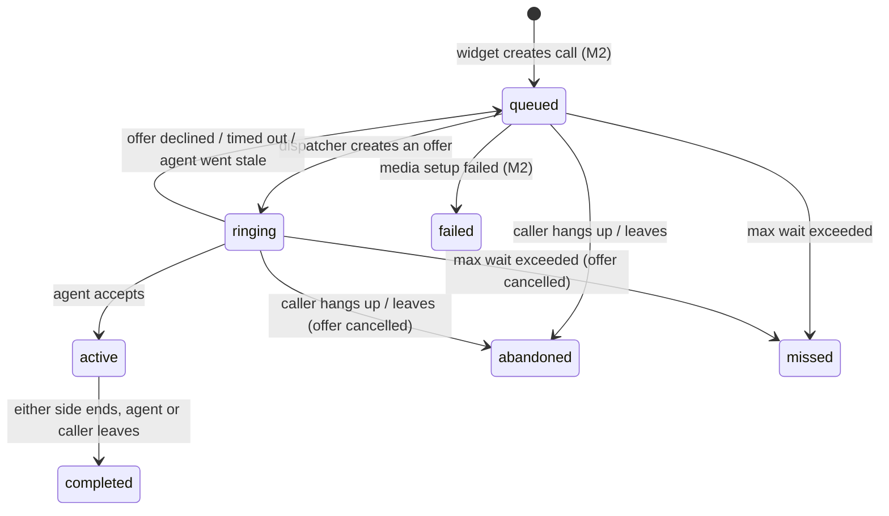

# M3 — Routing & Consoles (design, v0.2)

Status: **implemented** (see [Implementation notes](#16-implementation-notes)). Builds on `ARCHITECTURE.md` v0.4 (§3, §5, §9, §10, §11) and the M2 code.
Items are labelled **Decision** (already confirmed in v0.4), **Proposal** (my recommendation), **Assumption** or **Open question**.
Where this document differs from v0.4 it says so under [Changes to v0.4](#9-changes-to-v04-need-your-ok).

**Goal (from §14):** caller ↔ agent audio works end to end, including decline, timeout, abandon and missed.

**Not in M3:** recording (egress), text chat, callback form, call history pages (M4); plans/limits (M5).
**M3 calls are not recorded**, although D6 says recording is always on, so M3 must not be exposed to real callers before M4.

---

## 1. Scope

| Area | Included in M3 |
|------|----------------|
| Presence | Agent availability (`available` / `away` / `offline`), heartbeat, stale-agent sweeper |
| Routing | Dispatcher, offers with timeout, accept / decline, max-wait → `missed`, longest-idle selection, FIFO queue |
| Call lifecycle | `queued → ringing → active → completed`, agent hang-up, agent drop, new end reasons |
| Real-time | Server → browser event stream for the agent console and the live board |
| Agent console | `/agent`: availability toggle, incoming offer, in-call view (mute, end) |
| Supervisor board | `/live`: queues, active calls, agent states, scoped to assigned departments (D22) |
| Widget | New states: `ringing`, `active`, `missed` (message only, the callback form is M4) |

---

## 2. Call state machine



`calls.status` already contains all of these values, so no status migration is needed.
`call_offers.outcome`: `pending → accepted | declined | timeout | cancelled`.

New `end_reason` values: `agent_ended`, `agent_left`, `max_wait_exceeded`.
Existing: `caller_hung_up`, `caller_left`, `room_closed`, `media_unavailable`.

---

## 3. Data model (migration `00006_routing.sql`)

```text
agent_presence
  user_id PK, tenant_id,
  status            ('offline' | 'available' | 'away')      -- the agent's own choice
  status_changed_at, last_heartbeat_at,
  consecutive_timeouts smallint NOT NULL DEFAULT 0
  FOREIGN KEY (user_id, tenant_id) REFERENCES users (id, tenant_id) ON DELETE CASCADE
  INDEX (tenant_id, status, status_changed_at)              -- longest-idle lookup

call_offers
  id, tenant_id, call_id, agent_id, offered_at, expires_at, responded_at,
  outcome ('pending' | 'accepted' | 'declined' | 'timeout' | 'cancelled')
  composite FKs (call_id, tenant_id) and (agent_id, tenant_id)
  UNIQUE (call_id)  WHERE outcome = 'pending'               -- a call has at most one live offer
  UNIQUE (agent_id) WHERE outcome = 'pending'               -- an agent has at most one live offer
  INDEX (expires_at) WHERE outcome = 'pending'
  INDEX (call_id, offered_at)                                -- "who was already offered this call"

calls (altered)
  + assigned_agent_id uuid, composite FK (assigned_agent_id, tenant_id) → users
  + CHECK (status <> 'active' OR assigned_agent_id IS NOT NULL)
  + UNIQUE (assigned_agent_id) WHERE status = 'active'       -- an agent has at most one active call
  + INDEX (assigned_agent_id, queued_at DESC)
```

- Both tables get RLS with the same `tenant_isolation` policy, `FORCE`d, granted to `callcenter_app` (SELECT/INSERT/UPDATE; offers are history, never deleted by the runtime role).
- **Proposal — "busy" is derived, not stored.** v0.4 §9 lists `busy` in `agent_presence.status`. Storing it duplicates what the calls table already says and the two could drift. Instead an agent's *effective* state is computed:
  `offline` / `away` → as stored; `available` + pending offer → `ringing`; `available` + active call → `on_call`; otherwise `idle`.
  The two partial unique indexes above make "one offer, one call at a time" a database guarantee (assumption 4 in §13).
- Presence rows are created lazily on first status change. No row = `offline`.

---

## 4. Routing

### 4.1 Dispatcher

One function, `Dispatch(tenantID)`, runs in a platform transaction that first takes the existing `LockTenant` row lock (`SELECT … FOR UPDATE` on the tenant, already used when creating calls). Per tenant it is therefore serialized across every API instance. That is simpler and easier to reason about than `SKIP LOCKED` queue gymnastics, and the lock is held for milliseconds. v0.4 §5.1 mentioned `SKIP LOCKED`; this replaces it.

```text
loop, oldest call first:
  for each call WHERE status = 'queued' ORDER BY queued_at:
    candidate = agents WHERE
        member of call.department_id                           (D10)
      AND presence.status = 'available'
      AND presence.last_heartbeat_at > now() - stale_after
      AND no pending offer AND no active call
      AND no earlier offer for THIS call                       (see 4.4)
    ORDER BY presence.status_changed_at ASC                    -- longest idle
    LIMIT 1
    if none: continue to the next queued call
    insert call_offers(expires_at = now() + tenant.offer_timeout_seconds)
    UPDATE calls SET status = 'ringing'
    NOTIFY user:<agent>, dept:<department>
```

Because the outer loop is oldest-call-first and an agent can match calls from several departments, a freed agent automatically gets **the oldest queued call across all their departments** (§5.1).
A single pass over the tenant's queue is enough; the number of queued calls is capped (`maxLiveCallsPerTenant` = 50).

### 4.2 When it runs

| Trigger | Mechanism |
|---------|-----------|
| Call created, agent set to `available`, call ended, offer declined | Service calls `Dispatcher.Trigger(tenantID)` after its transaction commits. Triggers are coalesced per tenant by one worker goroutine. |
| Offer expiry, max wait, stale heartbeat, anything missed | **Sweeper**, every 2 s, finds tenants with expired pending offers, overdue queued/ringing calls, stale `available` agents, or queued calls with an idle agent, and dispatches them. |

Correctness never depends on `Trigger`: the sweeper alone would be enough, `Trigger` only removes up to 2 s of latency. Every API instance runs the sweeper; the tenant lock makes duplicate work harmless.

### 4.3 Offer lifecycle

| Event | Effect (one transaction, under the tenant lock) |
|-------|--------------------------------------------------|
| **Accept** | `UPDATE call_offers … WHERE id = $1 AND agent_id = me AND outcome = 'pending' AND expires_at > now()`, then `UPDATE calls SET status='active', assigned_agent_id, answered_at WHERE id = $2 AND status = 'ringing'`. Either update touching 0 rows → `409 offer_expired`. `consecutive_timeouts` reset to 0. After commit: agent join token returned. |
| **Decline** | Offer → `declined`; call → `queued` (keeps its original `queued_at`, so it keeps its place); trigger dispatch. |
| **Timeout** (sweeper) | Offer → `timeout`; call → `queued`; `consecutive_timeouts + 1`; at **2** the agent becomes `away` (v0.4: "repeated timeouts → away"; the threshold 2 is mine); trigger dispatch. |
| **Max wait** (sweeper) | Call is `queued` or `ringing` and `now() - queued_at > max_queue_wait_seconds` → `missed`, `end_reason = max_wait_exceeded`, pending offer → `cancelled`, room deleted. |
| **Caller leaves / hangs up** while `ringing` | Existing `End` plus pending offer → `cancelled`. The agent's console clears the offer. |
| **Agent stale** (no heartbeat for `stale_after`) | `available`/`away` agent → `offline`; a pending offer is `cancelled` (not counted as a timeout) and the call goes back to `queued`. |

### 4.4 Who is not offered a call again
**Assumption:** an agent who declined or timed out on a given call is not offered *that call* again. In a one-agent department an unanswered call therefore waits until max wait → `missed`, rather than ringing the same person repeatedly.

### 4.5 In-call
- **Agent ends:** `POST /v1/agent/calls/{id}/end` → `completed`, `agent_ended`, room deleted, dispatch triggered.
- **Caller ends / leaves:** already handled in M2; `active` → `completed`.
- **Agent drops:** the media webhook `participant_left` with identity `agent:<user id>` → LiveKit has already applied its 20 s departure grace → call `completed` with `agent_left`, the agent set `offline`.
- **Agent reloads the console mid-call:** the snapshot returns the active call and `GET /v1/agent/calls/{id}/media` issues a fresh agent token for the same room, as long as the call is still `active` and assigned to that agent.
- **Agent stale while on a call:** the heartbeat sweeper does not end calls. LiveKit is the source of truth for media; the call ends via `participant_left`.

### 4.6 Availability for callers (changes the M2 widget check)
**Proposal:** `widget.Availability` gains `no_agents`: the department is inside business hours but **no member has `status = 'available'` with a fresh heartbeat**. Agents currently on a call still count: they are busy, not absent, so the caller queues. Call creation then returns `409 no_agents` and the widget shows "Nobody is available right now". v0.4 §4 step 2 says this case shows the callback form; the form arrives in M4, so M3 shows the message and M4 swaps the message for the form.
Calls that were already queued when the last agent goes offline stay queued until max wait (assumption 3 in §13).

---

## 5. Real-time events

**Proposal:** server → browser events use **Server-Sent Events**, not WebSockets (§9 explains why), and Postgres `LISTEN/NOTIFY` for cross-instance fan-out instead of Redis.

**Events are hints, state is fetched.** The stream only says *"something changed for you"*; the client then reads a snapshot over a normal authenticated request (`/v1/agent/session`, `/v1/live/board`). A missed event is harmless because the next event or the reconnect snapshot restores the truth. There is no event-ordering or delta protocol to get wrong.

```text
topics:   user:<user id>      agent console
          dept:<department id> live board (and supervisors' queue counters)
publish:  SELECT pg_notify('cc_events', '<topic>')  inside the same transaction as the state change
          → delivered only if the transaction commits (no phantom events)
consume:  one dedicated LISTEN connection per API process → in-process hub → subscribed SSE streams
```

NOTIFY payloads are tiny (a topic), far below the 8 kB limit. Identical notifications in one transaction are de-duplicated by Postgres.

**Path through the BFF.** The browser still talks only to Next.js (HttpOnly cookie, no CORS, no WebSocket tickets, the API stays off the public network):
`browser ⇄ Next route handler /api/agent/events (EventSource, reads cookie) ⇄ Go API GET /v1/agent/events (Bearer)`.
Streams send a comment keep-alive every 20 s and close after 15 minutes (the browser reconnects automatically), which also refreshes a supervisor's department assignment.

Commands (accept, decline, end, presence) are ordinary POSTs through server actions, as everywhere else.

---

## 6. API

All under the authenticated tenant scope; the tenant always comes from the session.

| Method & path | Who | Purpose |
|---------------|-----|---------|
| `GET /v1/agent/session` | department member | Snapshot: presence, pending offer (with caller name/phone and department), active call, `stale_after` / heartbeat interval |
| `PUT /v1/agent/presence` `{status}` | department member | `available` / `away` / `offline`. Going `available` triggers dispatch. Needs a prior heartbeat (see below) |
| `POST /v1/agent/presence/heartbeat` | department member | Refreshes `last_heartbeat_at` (every 10 s) |
| `GET /v1/agent/events` | department member | SSE stream (`user:<id>`) |
| `POST /v1/agent/offers/{id}/accept` | the offered agent | → `{call, media_url, media_token}` |
| `POST /v1/agent/offers/{id}/decline` | the offered agent | 204 |
| `POST /v1/agent/calls/{id}/end` | the assigned agent | 204 |
| `GET /v1/agent/calls/{id}/media` | the assigned agent | Fresh agent token while the call is `active` |
| `GET /v1/live/board` | supervisor (own departments), tenant admin (all) | Per department: queued count + oldest wait, active calls (agent, caller name, duration), agent effective states |
| `GET /v1/live/events` | same | SSE stream (`dept:<id>` for each visible department) |

- **Authorization is in the service**, not the handler: an agent can only act on offers addressed to them and calls assigned to them (other tenants' and other agents' ids return 404, never 403, to avoid confirming existence). Supervisors are limited to `department_supervisors` rows; tenant admins see everything in the tenant.
- **Assumption (v0.4 §3):** any tenant user who is a *member* of at least one department can use `/v1/agent/*`, whatever their role. Users with no membership get 403.
- Request bodies are dedicated DTOs with `Validate()`; the presence status is an allow-list.
- Caller-facing status: `ringing` is exposed to the widget as-is. The caller still polls every 3 s (latency of the "connected" label only; audio starts the moment the agent joins the room).
- Agents get LiveKit tokens with `RoleAgent`, identity `agent:<user id>`, 10-minute TTL, microphone only, no data publishing — the same limits as callers. The media-event handler learns `agent:` identities (it currently ignores them).

**Constants** (single file, named, no magic numbers): heartbeat 10 s · stale after 30 s · sweeper 2 s · timeouts before `away` 2 · SSE keep-alive 20 s · SSE max age 15 min. Offer timeout and max wait remain **tenant settings** (already in `tenant_settings`).

**Audit:** presence changes and call routing are *not* written to `audit_logs` (high volume, not administrative actions). The offer rows themselves are the history and feed the "offer timeline" on the M4 call detail page.

---

## 7. Backend structure

```text
internal/
  presence/   model, repository, service (status changes, heartbeat, stale sweep), handler
  routing/    dispatcher (+Trigger worker), offer service (accept/decline/timeout/max-wait), sweeper, handler
  realtime/   Bus (pg LISTEN/NOTIFY), Hub (topic → subscribers), SSE writer
  board/      read model for the live board, handler
  call/       + agent end, ringing-offer cancellation, new end reasons; gains a small Dispatcher interface
  media/      + agent role/identity (Provider interface unchanged)
```

- `call` depends on `routing` only through a one-method `Dispatcher` interface (`Trigger(tenantID)`), implemented by `routing` and wired in `app` — no import cycle, and `call` stays testable with a fake.
- `routing` owns the offer rules; ending a call still goes through `call.Service` (one place that moves a call to a terminal state — no duplicated logic).
- `board` is read-only and holds all supervisor scoping, so the dispatcher never carries presentation concerns.

## 8. Frontend

```text
web/app/agent/            page.tsx (console), actions.ts (presence, accept, decline, end), AgentConsole.tsx
web/app/live/             page.tsx (board), LiveBoard.tsx
web/app/api/agent/events/ route.ts      -- SSE proxy, cookie → Bearer
web/app/api/live/events/  route.ts
web/lib/media/            useLiveKitRoom.ts   -- mic publish, remote audio, mute: extracted from the widget's useCallSession
web/lib/realtime/         useEventStream.ts   -- EventSource + "refetch on change" + reconnect state
```

- **Agent console states:** offline · going online (microphone permission requested *before* `available`, since an agent who can't capture audio must not receive calls) · idle · ringing (ringtone, Accept / Decline, countdown from `expires_at`) · on call (caller details, duration, mute, End) · connection-lost banner · empty / error.
- The ringtone is unlocked by the user's click on "Go available" (browser autoplay rules). Accept is also a gesture, so remote audio plays.
- **Live board:** one card per visible department: open/closed, queued count with the oldest wait, agents with effective state, active calls with duration; empty and error states; refetches on each event with a short debounce.
- **Navigation:** agents land on `/agent`; supervisors on `/live`; tenant admins get both in the sidebar. `requireRole` is called in every page, as in M1/M2.
- **Widget:** `ringing` → "Connecting you to an agent…"; `active` → the in-call view it already has; `missed` → "Sorry, nobody was available" (M4 adds the callback form); `no_agents` message on the pre-call screen.
- The widget's `useCallSession` keeps its polling and hang-up; only mic/audio code moves to the shared hook. No behaviour change for callers.

---

## 9. Changes to v0.4 (need your OK)

| # | v0.4 said | M3 proposes | Why |
|---|-----------|-------------|-----|
| C1 | Browser ⇄ API **WebSocket** with single-use ticket (§2, §10) | **SSE** through a Next route handler | Traffic is one-way (server → browser); commands are already HTTP. Keeps the "browser talks only to Next.js" rule, no CORS, no ticket endpoint, no WebSocket library, automatic reconnect. |
| C2 | **Redis** pub/sub for fan-out (§2) | Postgres **LISTEN/NOTIFY**, no Redis in M3 | NOTIFY is transactional (events only on commit), needs no new service, and LiveKit does not need Redis for a single node. Redis can be added later behind the `Bus` interface if hosting needs it (D15 keeps this open). |
| C3 | `agent_presence.status` includes `busy` (§9) | `busy` is derived from offers/calls | One source of truth; DB unique indexes enforce one call per agent. |
| C4 | `SKIP LOCKED` dispatch (§5.1) | Per-tenant lock (`LockTenant`) | Serialized dispatch is simple to prove correct; contention is per tenant and brief. |
| C5 | Callback form when no agent is online (§4) | Message in M3, form in M4 | The callback feature is M4. |
| C6 | Packages `presence`, `call`, `realtime` (§10) | Adds `routing` and `board` | Single responsibility: dispatcher/offers and the supervisor read model do not belong in `call`. |

---

## 10. Failure & edge cases

| Case | Behaviour |
|------|-----------|
| Two agents race to accept / agent accepts after expiry | Conditional updates: exactly one transaction wins, others get `409 offer_expired`. |
| Caller hangs up while the offer is on screen | Offer cancelled, event clears the console; a late Accept returns `409`. |
| Agent closes the tab while `available` | Heartbeat stops → `offline` within `stale_after`; a pending offer is cancelled and the call re-queued (not counted as a timeout). |
| Agent's network flaps during a call | LiveKit reconnects within its 20 s grace; otherwise `participant_left` → `agent_left`. |
| API restarts | No in-memory state matters: the sweeper rebuilds everything from Postgres; SSE clients reconnect and refetch. |
| Two API instances | Tenant lock serializes dispatch; each instance fans out events from its own LISTEN connection. |
| Event stream silently dies | Client shows "connection lost", reconnects, refetches the snapshot; the 10 s heartbeat is independent. |
| Department deactivated / agent removed from department with a pending offer | Offer is cancelled and the call re-queued on the next dispatch pass. |
| Agent deleted / disabled | Presence row cascades; pending offer and active call are ended by the same rules as stale. |
| Max wait smaller than offer timeout | Max wait wins (checked first by the sweeper). |
| Tenant suspended | Existing M1 behaviour (sessions revoked); new calls already refused by the widget resolver. |

## 11. Security

- Tenant scope from the session only; every new table has RLS and composite tenant FKs. Integration tests extend the existing RLS suite to `agent_presence` and `call_offers`.
- Offer ids are unguessable UUIDv7 *and* checked against `agent_id = me` in SQL; a foreign id is a 404.
- SSE: authenticated like any request, per-user connection cap (3), topics are derived server-side from the session — a client never names a topic.
- Agent media tokens are scoped to a single room, short-lived, microphone-only.
- Supervisor scoping lives in one place (`board`) and is covered by tests (supervisor of department A sees nothing of department B).
- Heartbeat and presence endpoints sit behind the existing per-IP rate limiter plus a per-user limit.

## 12. Testing

| Level | What |
|-------|------|
| Unit | Effective-state derivation; constants/threshold logic; DTO validation; availability with `no_agents`. |
| Integration (Postgres, existing harness) | Dispatcher: longest-idle choice · FIFO across departments · multi-department agent gets the oldest call · skips busy/away/stale/non-member · decline → next agent · timeout → next agent and `away` after 2 · exhausted candidates wait · accept race (parallel goroutines, exactly one winner) · max wait → `missed` · stale agent frees its offer · tenant isolation on both new tables · supervisor scoping. |
| API smoke (`smoke_m3.py`) | Full HTTP flow with two tenants: sign in agent, heartbeat, go available, widget call, offer appears in `/agent/session`, accept, end, plus decline/timeout/missed paths. |
| Media | LiveKit CLI joins as the agent identity to verify `participant_joined` / `participant_left` handling (as done in M2). |
| Manual | Real two-way audio: widget in one browser window, agent console in another (headphones to avoid echo). The in-app browser cannot grant microphone access, so this step is yours. |

Per the working agreement, the full suite runs once after implementation, not after every change.

## 13. Assumptions

1. Any tenant user who is a department member can take calls; the role only decides which other pages they see (v0.4 §3).
2. No after-call wrap-up time in v1: when a call ends the agent is immediately `idle` and may receive the next one. (Easy to add later as a per-department delay.)
3. Calls already queued when the department closes or the last agent leaves stay queued until max wait (v0.4 §13.3).
4. One call per agent at a time (v0.4 §13.4), enforced by unique indexes.
5. An agent who declined or timed out on a call is not offered that call again (§4.4).
6. If an agent drops mid-call, the call ends; there is no "reconnect and resume" beyond LiveKit's 20 s grace.
7. Agents must grant microphone permission before they can go `available`.

## 14. Open questions

1. **C1 — SSE instead of WebSocket?** Recommended: yes.
2. **C2 — No Redis in M3?** Recommended: yes (revisit when hosting is chosen).
3. **No agent online at call start (§4.6):** show "nobody is available" and don't queue (recommended, matches v0.4 §4), **or** queue the call anyway until max wait?
4. **Seeing caller details on an offer:** the agent sees the caller's name, phone and email *before* accepting (useful to decide, but it is personal data shown to a person who may decline). Recommended: show **name only** before accepting, everything after. OK?

## 15. Implementation order (backend first)

1. Migration `00006` + RLS tests for the new tables.
2. `presence` (service, heartbeat, stale sweep) and its API.
3. `routing` dispatcher + offers + sweeper (integration tests for the rules in §12).
4. `call` changes: ringing cancellation, agent end, agent-leave webhook, `no_agents` availability.
5. `realtime` bus/hub and the two SSE endpoints; `board` read model.
6. `smoke_m3.py` and LiveKit CLI media check.
7. Frontend: shared hooks → agent console → live board → widget states.
8. Fold the accepted changes into `ARCHITECTURE.md` (→ v0.5), update the README status.

## 16. Implementation notes

The design was approved with all four open questions answered as recommended (SSE, no Redis, "nobody available" message instead of queueing, name-only before accepting). Differences from the text above:

- `agent_presence` also stores **`idle_since`**: it moves when an agent becomes available, finishes a call or declines/times out, so "longest idle" is exact (the design used `status_changed_at`, which would have kept favouring agents who had simply been available the longest).
- `calls.assigned_agent_id` uses `ON DELETE SET NULL` and the planned `CHECK (status <> 'active' OR assigned_agent_id IS NOT NULL)` was **dropped**, because deleting a user mid-call would otherwise fail. `call_offers.agent_id` is nullable for the same reason. A ringing call that loses its offer is returned to the queue by the sweeper.
- The sweeper visits every tenant with a `queued` or `ringing` call, plus tenants with stale agents (simpler than three separate discovery queries; at most 50 live calls per tenant).
- Closing the room of a **missed** call happens after the transaction commits, like every other media call.
- Event streams are limited to 3 per user across the agent console and the live board.
- The agent console's microphone check happens when the agent goes available, as designed. If the microphone cannot start after accepting, the agent leaves the room, the call ends (`agent_left`) and the agent goes offline.
- The `/home` placeholder page was removed; agents land on `/agent` and supervisors on `/live`.
