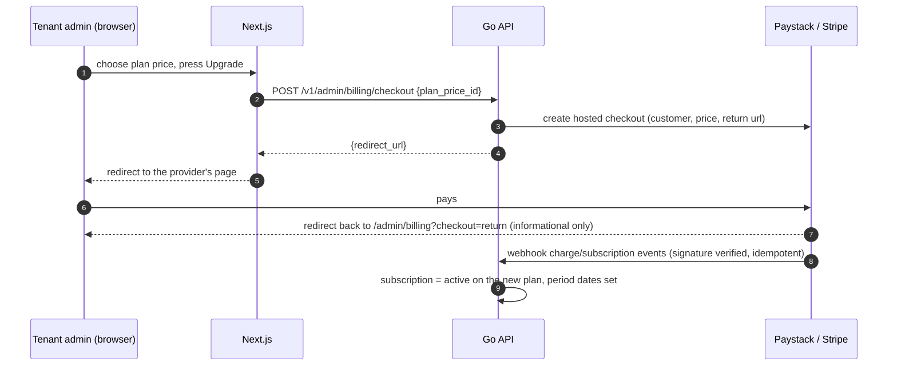

# M5 — Plans, Billing & Limits (design, v0.2)

Status: **implemented** (see [Implementation notes](#17-implementation-notes)). Builds on `ARCHITECTURE.md` v0.6 (§8, §9, D12, D13, D16–D19) and the M1–M4 code.
Labels: **Decision** (already confirmed), **Proposal** (my recommendation), **Assumption**, **Open question**.

**Goal (from §14):** a tenant upgrades through Paystack, the limits change, overage is charged at period close, and a failed payment downgrades after 14 days. Stripe follows Paystack behind the same interface.

**Not in M5:** invoices as PDFs, tax/VAT, coupons, free trials, refunds, per-use billing screens beyond the usage meters, switching a subscription's currency in place.

---

## 1. The one thing to settle first: live provider access

I cannot reach Paystack or Stripe from here, and I have no test keys. M5 is therefore built so that **everything except the last mile is verifiable on this machine**:

- A `billing.Provider` interface with a **fake provider** (in-memory, used by tests and by local development) and the real **Paystack** and **Stripe** adapters.
- The adapters are verified against **local fake HTTP servers** that return the providers' documented response shapes, and against **signed webhook fixtures** built with the providers' documented signature schemes (Paystack: HMAC-SHA512 of the body with the secret key; Stripe: HMAC-SHA256 over `timestamp.body`, five-minute tolerance).
- What this **cannot** prove: that my reading of each provider's API still matches reality (field names, event ordering, edge cases). That needs one real test-mode checkout per provider. I will leave a short, ordered **sandbox checklist** in the README and report the live run as **not done** unless you give me test keys (open question 1).

---

## 2. Scope

| Area | Included |
|------|----------|
| Plans | Platform-admin CRUD of plans, prices (currency × interval, overage rates) and their provider sync; exactly one free plan |
| Subscriptions | Free tier by default, hosted checkout to upgrade, cancel at period end, plan change, status from verified webhooks only |
| Limits | Agent seats, departments, widgets, call minutes per month, recording storage, enforced in services |
| Cap policies | Per-cap `block` / `overage` chosen by the tenant admin (paid plans only) |
| Overage | Usage snapshot at period close and a charge through the provider |
| Failure | `past_due` for 14 days, then automatic fallback to the free tier |
| Notices | Admin emails at 80% and 100% of each cap, and on payment failure |
| UI | Platform: plans, prices, tenant subscription/usage, payments. Tenant: billing page (plan, meters, policies, upgrade, cancel, payment history) |

---

## 3. Model

### 3.1 Plans and prices (global, owned by the platform)
```text
plans
  id, code UNIQUE, name, description, is_free, is_public, is_active,
  max_agents, max_call_minutes_per_month, max_storage_bytes, max_departments, max_widgets   (NULL = unlimited)
  UNIQUE (is_free) WHERE is_free                    -- exactly one free tier

plan_prices                                         -- paid plans only
  id, plan_id FK, currency (ISO 4217), interval ('monthly'|'yearly'), amount_minor bigint,
  overage_per_minute_minor bigint, overage_per_gb_minor bigint,     -- D16, same currency
  provider ('paystack'|'stripe')  -- derived from currency (D19), stored for clarity
  external_id NULL                                  -- Paystack plan_code / Stripe price id, set by "sync"
  is_active
  UNIQUE (plan_id, currency, interval)
```
- **Deviation from v0.5 §9:** the `plan_price_provider_refs` table is dropped. D19 makes the provider a function of the currency, so one price has exactly one provider reference and two columns are enough.
- The free plan has no prices. **Seed:** a free plan is created by the migration (2 agents, 100 call minutes, 500 MB, 2 departments, 1 widget; editable by the platform admin; open question 4).
- Plans in use by subscriptions cannot be deleted, only deactivated. The free plan can be edited but not deactivated or deleted.
- RLS: plans and prices are **readable by every signed-in tenant** (they choose among them) and **writable only by the platform** (`app_is_platform()`).

### 3.2 Subscriptions (one per tenant)
```text
subscriptions
  id, tenant_id UNIQUE, plan_id FK, plan_price_id FK NULL (NULL on free),
  provider NULL, external_customer_id NULL, external_subscription_id NULL, external_authorization NULL,
  status ('active'|'past_due'|'cancelled'|'incomplete'),
  past_due_since NULL, cancel_at_period_end bool,
  current_period_start, current_period_end
```
- Created for every tenant at provisioning (on the free plan) and **backfilled by the migration** for existing tenants.
- `external_authorization` holds Paystack's reusable card authorization (used for overage and renewals); it is a provider token, not card data, and is never returned by the API.
- **Free-tier periods are calendar months in UTC**; paid periods follow the provider's billing cycle.

### 3.3 Usage, payments, webhooks
```text
usage_periods        id, tenant_id, subscription_id, period_start, period_end, call_seconds, storage_bytes,
                     overage_amount_minor, currency, overage_payment_id NULL    UNIQUE (tenant_id, period_start)
payments             id, tenant_id, subscription_id, kind ('subscription'|'overage'), provider,
                     external_reference UNIQUE, amount_minor, currency, status ('succeeded'|'failed'|'refunded'), paid_at
billing_webhook_events   id, provider, external_event_id, type, payload jsonb, processed_at, error
                     UNIQUE (provider, external_event_id)                          -- platform only, no tenant RLS
usage_notices        tenant_id, period_start, cap ('minutes'|'storage'), threshold (80|100)   PK on all four  -- send each email once
tenant_settings (altered)   + minutes_cap_policy, storage_cap_policy ('block'|'overage'), default 'block'
```
- `subscriptions`, `usage_periods`, `payments`, `usage_notices` get the usual tenant RLS and composite tenant FKs; the runtime role cannot delete them.
- Money is **always `bigint` minor units** plus a currency code. No floats.

---

## 4. Usage and limit enforcement

### 4.1 Measuring (indexed sums, no counter tables, as proposed in §8)
- **Call seconds** in the current period: `SUM(ended_at − answered_at)` over calls answered in the period and finished. Calls still in progress count when they end (we never cut a call because it crossed a cap).
- **Storage bytes:** `SUM(size_bytes)` of **all** the tenant's recordings, soft-deleted ones included (D17). A tenant can therefore never lower its usage by deleting; the billing page says so.
- **Agent seats:** distinct active users who are a member of at least one department. **Departments / widgets:** row counts.

### 4.2 Where each limit is checked
| Limit | Checked | Result when exceeded |
|-------|---------|----------------------|
| Agent seats | Adding members to a department; enabling a user who is a member | `409 plan_limit` with the limit named |
| Departments, widgets | Creating them | `409 plan_limit` |
| Call minutes | Creating a call, and in the widget's availability | policy `block` → **widget shows the callback form** and call creation returns `409 limit_reached`; policy `overage` → allowed |
| Recording storage | Same | Same |

One `limits.Service` owns these rules; the other services call it through a small interface (no limit logic duplicated in user/department/widget/call code). Limits are enforced in the **service layer, never the UI**.

### 4.3 Downgrade to a smaller plan
- Resources over the new limits are **never deleted**; creating more is blocked.
- **Seats:** if more agents exist than seats, the agents with the **earliest department membership keep their seat** and the others cannot go available until the admin removes members or the plan grows (assumption 3; no new "choose who stays" screen). The billing page lists who is over the limit.
- On fallback to the free tier both cap policies reset to `block` (D16/D18).

### 4.4 Notifications
After a call ends and after a recording becomes ready, the tenant's usage is re-evaluated; the first time a cap reaches **80%** and **100%** in a period, the admins get one email (`usage_notices` makes it once). Payment failure and fallback also email the admins.

---

## 5. Checkout, subscription state and renewal

**Subscription state changes only in response to verified webhooks, never from the browser redirect** (v0.5 §8).



- **Paystack:** `transaction/initialize` with the plan code; on `charge.success` / `subscription.create` the authorization and subscription code are stored. Renewals are Paystack-driven (`charge.success`, `invoice.payment_failed`). **Stripe:** Checkout Session in subscription mode; `checkout.session.completed`, `invoice.paid`, `invoice.payment_failed`, `customer.subscription.deleted`.
- **Provider by currency (D19):** the price's currency decides; the tenant never picks a provider. Config: `BILLING_PAYSTACK_CURRENCIES` (default `NGN`).
- **Plan change (proposal, open question 3):** choosing another price starts a **new checkout; the old subscription is cancelled when the new one activates**, with **no proration and no refund** in v1. Cancelling just stops renewal at the period end (`cancel_at_period_end`); the tenant keeps the paid plan until then, then falls to the free tier.
- Webhooks are verified, stored in `billing_webhook_events` (unique by provider event id → replays are no-ops) and mapped to internal events: `subscription.activated`, `payment.succeeded`, `payment.failed`, `subscription.cancelled`. Unknown events are stored and ignored.
- The billing service depends only on `billing.Provider` and the internal events:

```go
type Provider interface {
    Name() ProviderName
    SyncPrice(ctx, PlanPrice) (externalID string, err error)
    CreateCheckout(ctx, CheckoutRequest) (redirectURL string, err error)
    CancelSubscription(ctx, externalSubscriptionID string, atPeriodEnd bool) error
    ChargeOverage(ctx, OverageCharge) (externalReference string, err error)
    ParseWebhook(r *http.Request) (Event, error)   // verifies the signature
}
```

## 6. Period close and overage

A sweeper (the existing 2-second router loop is the wrong place; a dedicated 1-minute loop in `billing`) closes every subscription whose `current_period_end` has passed:

1. In one transaction: snapshot usage into `usage_periods` (call seconds, storage bytes) and compute the overage **only for caps whose policy is `overage`**: `ceil(excess minutes) × overage_per_minute` and `ceil(excess GB) × overage_per_gb` (rounded up to whole units, assumption 4).
2. If the amount is above zero, charge it through the provider (`ChargeOverage`); record the result in `payments`. **The charge is made once**: `usage_periods.overage_payment_id` and a unique key on the period make a repeated sweep a no-op.
3. A failed overage charge puts the subscription in `past_due` (below). A successful or zero overage rolls the period forward.
4. Free-tier tenants: nothing to charge, the period rolls to the next calendar month.

## 7. Payment failure and fallback (D18)

`payment.failed` → `past_due`, `past_due_since` set, admins emailed. `payment.succeeded` within **14 days** → `active`. The 1-minute sweeper moves subscriptions that have been `past_due` for 14 days to the **free plan** (status `active`, policies reset to `block`, admins emailed). While `past_due`, the paid limits still apply (grace).

## 8. API and pages

| Method & path | Who |
|---------------|-----|
| `GET/POST /v1/platform/plans`, `GET/PUT/DELETE …/{id}`; `POST …/{id}/prices`, `PUT/DELETE …/prices/{id}`, `POST …/prices/{id}/sync` | platform admin |
| `GET /v1/platform/tenants/{id}/billing` (subscription, usage, payments) | platform admin |
| `GET /v1/plans` (active public plans with prices) | any tenant user |
| `GET /v1/admin/billing` (plan, limits, usage meters, policies, payments) | tenant admin |
| `PUT /v1/admin/billing/policies` | tenant admin (`overage` only on a paid plan) |
| `POST /v1/admin/billing/checkout`, `POST /v1/admin/billing/cancel`, `POST /v1/admin/billing/resume` | tenant admin |
| `POST /v1/webhooks/paystack`, `POST /v1/webhooks/stripe` | providers (signature, no session) |

```text
web/app/platform/plans/          list · new · [id] (limits, prices, sync) · [id]/edit
web/app/platform/tenants/[id]    + subscription, usage and payments card
web/app/admin/billing/           plan, meters (minutes, storage, seats, departments, widgets), cap policies, upgrade/cancel, history
web/app/admin/                   overview shows usage against limits and a banner when past_due or over a limit
web/app/widget/                  "we're at capacity" state → callback form
```
Every page has loading, empty, error and success states, like the rest of the app. Provider return URLs land on `/admin/billing` and show "processing" until the webhook has updated the subscription.

## 9. Backend structure

```text
internal/billing/        plans, prices, subscriptions, usage, payments, checkout, webhooks, period sweeper (+ handler)
  provider.go            Provider interface and internal event types
  paystack/  stripe/     thin stdlib HTTP clients (no vendor SDK; open question 2)
  fake/                  in-memory provider for tests and local development
internal/limits/         limit checks (seats, departments, widgets, minutes, storage) and usage numbers
```
`user`, `department`, `widget` and `call` get a one-method `Limits` interface (as `call` has for routing); the billing handlers and sweeper wire in `app`.

## 10. Failure & edge cases

| Case | Behaviour |
|------|-----------|
| Webhook replayed or delivered out of order | Stored by provider event id; handlers only move state forward (conditional updates) |
| Webhook signature wrong or timestamp stale | 401, nothing stored |
| Browser redirect arrives before the webhook | Page shows "processing"; nothing changes until the webhook |
| Checkout abandoned | No subscription change; the tenant stays on its plan |
| Provider outage during checkout | Clear error; no partial state (checkout creates nothing locally until the webhook) |
| Overage charge fails | `past_due`; usage snapshot kept; the sweeper does not recharge the same period |
| Cap reached mid-call | The call continues; the next call follows the policy |
| Tenant downgraded below current usage | Nothing deleted; creation and calls follow the new limits (§4.3) |
| Plan deleted while subscribed | Refused; deactivate instead |
| Platform admin edits a plan's limits | Applies to every subscriber immediately |
| Price changed after subscribers exist | Existing subscribers keep their price (the price row is never edited in place; a new price is added and the old one deactivated) |

## 11. Security

- Webhooks are signature-verified with constant-time comparison; Stripe's timestamp tolerance is enforced; the raw body is read once (size-limited) before parsing.
- Provider secrets live only in configuration; card data never touches our servers (hosted checkout). Stored provider tokens are never returned by the API.
- Tenant admins can read only their own subscription, usage and payments (RLS + service scope); plan and price writes are platform-only (RLS + route guard).
- All billing actions are audit-logged (plan/price changes, checkout started, cancel/resume, policy changes, fallback to free).

## 12. Testing

| Level | What |
|-------|------|
| Unit | Money/rounding rules, overage maths, period boundaries, event mapping, signature verification for both providers (good, tampered, stale) |
| Integration (Postgres, fake provider) | Every limit (create/enable beyond the cap, over-limit after downgrade), cap policies, period close (snapshot, one charge, rollover), 14-day sweeper (just before and after), webhook idempotency, plan/price rules (one free plan, in-use plans), RLS on the new tables |
| Adapter tests | Paystack and Stripe clients against local fake HTTP servers: request shapes, error mapping, timeouts |
| API smoke (`smoke_m5.py`) | Platform creates plan + price; tenant checks out with the fake provider and a signed webhook; limits change; overage charged at close; failure → past_due → fallback (time-shifted in the database) |
| Live | The sandbox checklist (§1): **not run** unless you provide test keys |

## 13. Changes to v0.6 (need your OK)

| # | Earlier text | M5 proposes | Why |
|---|--------------|-------------|-----|
| C1 | `plan_price_provider_refs` table (§9) | `provider` and `external_id` columns on `plan_prices` | D19 makes the provider a function of the currency |
| C2 | `stripe-go` dependency (§10) | Thin stdlib HTTP clients for Stripe and Paystack | Only a handful of calls are needed; avoids a large SDK and its version coupling |
| C3 | "The admin picks who stays active" after a seat downgrade (§8) | Earliest memberships keep their seats, no selection screen | No new screen; the admin can still change who has a seat by editing department members |
| C4 | Plan change not specified | New checkout, immediate switch, no proration or refund | Simplest behaviour that works on both providers |
| C5 | Widget shows the callback form when a cap blocks (§4) | New availability `limit_reached`, same callback form | Distinguishes it from "nobody online" for the admin's logs |

## 14. Assumptions

1. Free-tier periods are UTC calendar months; paid periods follow the provider's cycle.
2. Call time is counted from answer to end, in seconds; billing rounds the **excess** up to whole minutes and whole GB.
3. Seat holders after a downgrade are decided by earliest department membership (C3).
4. The seeded free plan (2 agents, 100 minutes, 500 MB, 2 departments, 1 widget) is a placeholder the platform admin will change.
5. No taxes, no invoices PDF, no refunds, no trials in M5.
6. One currency per subscription; changing currency means a new checkout.

## 15. Open questions

1. **Do you have Paystack and Stripe test-mode keys I can use, or will you run the sandbox checklist yourself later?** Recommended: build and verify everything against fakes now, and run the live checklist when keys are available.
2. **C2 — Thin stdlib clients instead of `stripe-go`?** Recommended: yes.
3. **C4 — Plan change as a new checkout with an immediate switch and no proration or refund?** Recommended: yes for v1.
4. **Free-tier numbers** (2 agents, 100 minutes, 500 MB, 2 departments, 1 widget): fine as the seed, or do you have different numbers in mind?

## 16. Implementation order (backend first)

1. Migration `00008` (plans, prices, subscriptions with backfill and free-plan seed, usage, payments, webhook events, usage notices, tenant cap policies) + RLS tests.
2. `limits` service and its integration into user/department/widget/call (with the widget `limit_reached` availability); tests per limit.
3. `billing` core: plans/prices CRUD, subscription state machine, internal events, fake provider, webhook intake with idempotency.
4. Checkout, cancel/resume, plan change, policies.
5. Period close, overage charge, 14-day fallback, usage emails.
6. Paystack adapter, then Stripe adapter (fake-server tests and signature tests).
7. `smoke_m5.py`, full suite.
8. Frontend: platform plans → tenant subscription card → tenant billing page → overview banner → widget capacity state.
9. Fold accepted changes into `ARCHITECTURE.md` (→ v0.7), README (including the sandbox checklist).

## 17. Implementation notes

Approved with all four open questions answered as recommended (fakes first and a live checklist later, thin stdlib clients, immediate plan switch without proration, the seeded free-tier numbers). Differences and findings:

- **Resume was dropped.** The design listed `POST /v1/admin/billing/resume`, but the provider interface has no "un-cancel" and Paystack cannot re-enable a disabled subscription without a customer email token. To continue after cancelling, the tenant chooses the plan again (a new checkout, which replaces the old subscription).
- **`plan_prices` stores `provider` and `external_id`** as designed (C1). Subscriptions also store a **`billing_email`**: Paystack needs the customer's email to charge a saved authorization, and the admin who pays may not be the admin who later triggers a charge.
- **Paystack announces the subscription id separately** (`subscription.create`) from the first payment (`charge.success`, which carries our metadata). A new internal event `subscription.linked` attaches the id to the tenant that owns the customer.
- **Provider-initiated cancellations are ignored while `cancel_at_period_end` is set**: Paystack sends `subscription.disable` right after we disable it, but the tenant keeps the plan until the period closes.
- **Overage is not charged to a subscription that is already `past_due`** (the snapshot still records it; falling back to the free plan forgives it). Charging is at-most-once: the usage snapshot row is the claim, so a crash between the snapshot and the charge under-bills rather than double-bills. Provider idempotency keys derive from the snapshot id.
- **Seats count invited users** who are department members (so an invitation reserves a seat), and exclude disabled users.
- **Usage warnings** (80% / 100%) are evaluated in the background when a call ends or a recording finishes, and sent once per cap, threshold and period.
- **Stripe overage uses a one-off invoice paid immediately.** Stripe pays it with the customer's default payment method; whether Checkout leaves one on the customer (rather than only on the subscription) must be confirmed in the live checklist below.
- **Development uses an in-memory provider** (`BILLING_FAKE`, default on outside production, refused in production). `/admin/billing/fake-checkout` stands in for the provider's page and sends the API a signed webhook.
- `database.IsForeignKeyViolation` now also recognises Postgres's RESTRICT error (23001), so deleting an in-use plan or price reports `plan_in_use` / `price_in_use`.

### Live sandbox checklist (not run: no provider keys were available)
Do these in order with test-mode keys, `BILLING_FAKE=false`, and the API reachable by the provider (a tunnel such as `ngrok` or `stripe listen`).

**Paystack** (`PAYSTACK_SECRET_KEY`, `BILLING_PAYSTACK_CURRENCIES=NGN`; webhook URL `…/v1/webhooks/paystack`)
1. Platform → Plans: add an NGN price and press Sync (a `plan_code` appears at Paystack).
2. As a tenant admin choose it and pay with a Paystack test card. Expect `charge.success` (plan activates, limits change, one payment row) then `subscription.create` (subscription id linked).
3. Cancel: expect the subscription disabled at Paystack, the tenant keeping the plan until the period ends.
4. Use a test card that fails on renewal (or disable the card): expect `invoice.payment_failed` → `past_due`.
5. Choose "pay for extra usage", push usage over the cap, move the period end into the past in the database, run a sweep: expect one `transaction/charge_authorization` and an overage payment row.

**Stripe** (`STRIPE_SECRET_KEY`, `STRIPE_WEBHOOK_SECRET` from `stripe listen --forward-to localhost:8080/v1/webhooks/stripe`)
1. Add a USD price and Sync (a product and recurring price appear).
2. Pay with `4242 4242 4242 4242`. Expect `checkout.session.completed` (plan activates) and `invoice.paid` (the first payment is recorded once).
3. Cancel at period end, then let the period close.
4. Pay with a card that fails on renewal: expect `invoice.payment_failed` → `past_due`.
5. Repeat the overage run. **Confirm the one-off invoice pays**; if Stripe reports no payment method, set the customer's `invoice_settings.default_payment_method` from the checkout session's payment method.
